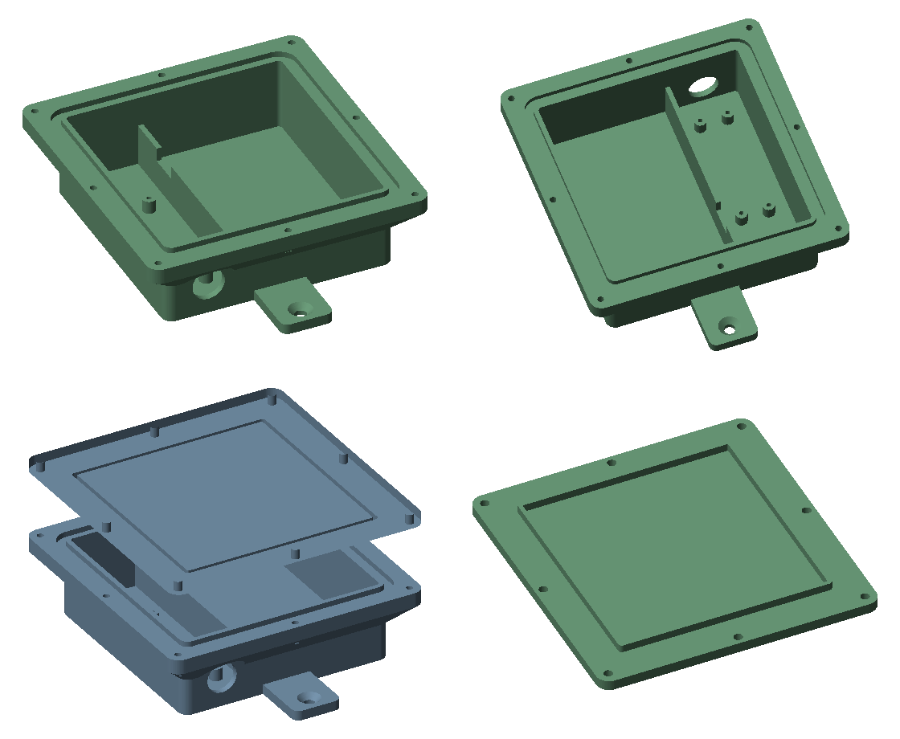

# Gehäuse für den Gartenfeuchtemesser

Wasserdichtes 3D-Druck-Gehäuse für **Pico W + 4,8-V-NiMH-Akkupack (4 × AA nebeneinander, 56,8 × 51 × 14,5 mm)**, mit Dichtnut
für eine Rundschnur, 8 Deckelschrauben, zwei Befestigungslaschen und Kabelverschraubung
für das Sensorkabel.

| Datei | Inhalt |
|---|---|
| `gehaeuse_unterteil.stl` | Unterteil, druckfertig (Boden aufs Druckbett) |
| `gehaeuse_deckel.stl` | Deckel, druckfertig (Außenseite aufs Druckbett) |
| `gehaeuse.scad` | Anpassbare Vorlage für OpenSCAD (Akkumaße, Wandstärken, Löcher) |
| `gehaeuse.py` | Erzeugt die beiden STL-Dateien (gleiche Maße wie die .scad) |

## Maße

| | |
|---|---|
| Unterteil außen | 88 × 91 mm, 31 mm tief; mit Dichtrand 108 × 111 mm |
| mit Laschen | 139 mm lang |
| Deckel | 108 × 111 × 4 mm (+ 3 mm Zentrierkragen) |
| Gesamttiefe mit Deckel | 35 mm |
| Innenraum | 83 × 86 × 28 mm |
| Pico-Fach | 28 mm breit, 4 Stege für M2-Schrauben, oben 25 mm frei für den USB-Stecker |
| Akkuschacht | 53 × 86 mm, der Akkupack liegt flach (Längsseite 56,8 mm nach oben/unten) |

**Anderer Akku?** In `gehaeuse.scad` oben `AKKU = [Länge, Breite, Höhe]` eintragen. Passt er nicht, meldet
OpenSCAD beim Rendern „Akku zu lang/zu hoch“ – dann `INNEN_L` bzw. `INNEN_H` vergrößern.

## Einkaufsliste

| Teil | Menge | Beispiel / Bezugsquelle |
|---|---|---|
| Rundschnur **Ø 3 mm**, Silikon oder EPDM | ca. 35 cm | [RS PRO Silikon-Dichtschnur Ø 3 mm × 5 m, RS 234-2909](https://de.rs-online.com/web/p/o-ring-schnure/2342909) · [RS PRO EPDM-Dichtschnur Ø 3 mm × 10 m, RS 234-1550](https://at.rs-online.com/web/p/o-ring-schnure/2341550) · als „Silikon Rundschnur 3 mm Meterware“ auch bei eBay/Amazon |
| Kabelverschraubung **PG7**, IP68, Kabel 3–6,5 mm, **mit Gegenmutter** | 1 | z. B. [Delock 60193 (PG7, IP68, 3–6,5 mm, 10 Stück)](https://delock.de/produkt/60193/merkmale.html) – prüfen, ob die Gegenmutter dabei ist, sonst eine mit Gegenmutter wählen (z. B. [Hilpress ECO IP67 mit Gegenmutter](https://www.hilpress.com/kabelverschraubungen-und-zubehoer/kabelverschraubungen-und-zubehoer-pg/standard-kunststoff-verschraubungen/eco-ip67-mit-gegenmutter)) |
| Schrauben M3 × 12, für Kunststoff (oder M3-Einschmelzmuttern + M3 × 10) | 8 | Baumarkt / Elektronikversand |
| Schrauben M2 × 6, selbstschneidend | 4 | für den Pico |
| Edelstahl-Senkkopfschrauben 4 × 30–40 mm + Dübel | 2 | Befestigung an Wand/Pfahl |
| Schottky-Diode 1N5817 | 1 | zwischen Akku (+) und VSYS, siehe unten |
| Trockenmittel-Beutel (Silicagel, klein) | 1 | gegen Kondenswasser |

## Drucken

- **Material:** ASA (UV-fest, beste Wahl für draußen) oder PETG. Kein PLA – es wird in der
  Sonne weich.
- **Wasserdicht drucken:** 4 Wände (Perimeter), 5 Boden- und Deckschichten, Infill 30–40 %.
- **Keine Stützen nötig:** Der Dichtrand hat unten eine 45°-Fase. Unterteil mit dem Boden
  aufs Bett, Deckel mit der glatten Außenseite aufs Bett.
- Die Bohrung für die PG7 liegt waagerecht in der Wand, außen mit einer flachen
  Auflage (dort ist die Fase des Dichtrands ausgespart); die kleine Brücke oben im Loch
  druckt jeder Drucker. Ggf. mit einem 12,5-mm-Bohrer nacharbeiten.

## Zusammenbau

1. **Kabelverschraubung** unten einsetzen, Gegenmutter innen fest anziehen.
2. **Pico** mit 4 Schrauben M2 auf die Stege, USB-Buchse zeigt zur Seite ohne Kabelloch
   (nach der Montage oben).
3. **Sensorkabel** durch die PG7 führen, am Pico anschließen (GP22, GND, GP26), Verschraubung
   zudrehen.
4. **Akkupack** in den großen Schacht, Kabel über die Aussparung der Trennwand zum Pico.
   Er liegt flach auf dem Boden; den Rest des Schachts
   mit einem Stück Schaumstoff füllen, damit nichts klappert.
5. **Rundschnur** in die Nut drücken, auf Länge schneiden (ca. 33 cm), Enden stumpf
   aneinanderstoßen und mit einem Tropfen Silikon-Dichtmasse verbinden. Die Schnur steht
   ca. 0,8 mm über – das ist die Verpressung.
6. **Trockenmittel** hinein, **Deckel** aufsetzen und die 8 Schrauben über Kreuz gleichmäßig
   anziehen, bis der Deckel ringsum aufliegt.
7. **Montage:** Kabel nach **unten**, Deckel nach vorn. Am besten geschützt unter einem
   Vordach oder auf der Nordseite – direkte Sonne heizt das Gehäuse auf.

## Akku: zwei wichtige Punkte

- **Spannung:** 4 frisch geladene NiMH-Zellen haben bis zu 5,8 V. Der Pico verträgt an
  **VSYS höchstens 5,5 V**. Darum gehört eine **Schottky-Diode 1N5817** in die Plus-Leitung
  (Ring zum Pico hin). Sie senkt die Spannung um ca. 0,3–0,4 V und schützt zugleich vor
  Verpolung. Akku-Plus → Diode → VSYS (Pin 39), Akku-Minus → GND (z. B. Pin 33).
- **Laufzeit:** Reale AA-NiMH-Zellen haben meist 2000–2500 mAh (Aufdrucke wie „4200 mAh“
  sind bei AA nicht erreichbar). Mit dauerhaft verbundenem WLAN (40–50 mA) reicht das nur
  für etwa 2 Tage – darum ist im Programm der **Sparmodus** eingeschaltet (WLAN nur im
  Fenster zur vollen Stunde und kurz zum Melden, dazwischen schläft der Pico). Damit sind
  grob 2 Wochen möglich; die echte Laufzeit misst der Testlauf auf der Akkuseite.
